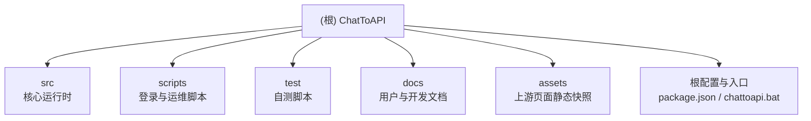

# ChatToAPI — 项目导航

> 把用户自行登录的 chatopens.ai（Sorux car / ChatGPT conduit）网页会话，通过 Playwright 驱动本机浏览器，转换为本地 OpenAI 兼容 API。

## 项目愿景

- **单机单账号**：只服务当前机器上用户自己登录的账号，不提供账号共享或第三方凭据导入。
- **凭据不落地为明文**：上游 Cookie / Bearer Token 仅以 AES-256-GCM 加密形式保存；对外只校验 `ctk_...` API Key 的 SHA-256 哈希。
- **OpenAI 兼容**：提供 `/v1/models` 与 `/v1/chat/completions`（流式与非流式），可接入常见 OpenAI SDK。
- **可运维**：Windows 下提供后台启动、停止、状态、监控与接管脚本。

## 架构总览

```text
OpenAI 客户端
  │ Authorization: Bearer ctk_...
  ▼
src/server.js       路由、API Key 鉴权、messages → prompt、SSE 重包装
  ▼
src/upstream.js     conduit 请求体、Windows curl.exe(Schannel) / Node http(s)、delta SSE 解析
  ▼
chatopens.ai 上游

登录链路（独立于对话链路）：
/auth/login
  → Playwright 持久化 Chromium
  → 注入已保存 Cookie / localStorage token
  → 打开 /Web/List.html
  → AutoVIP / AutoFree / Jump + car 入口
  → 监听 request / response
  → CredentialManager.captureHeaders()
  → AES-256-GCM
  → data/credentials.enc.json
```

### 模块结构图



## 模块索引

| 模块 | 一句话职责 | 入口 | 测试 | 配置 |
| --- | --- | --- | --- | --- |
| `src/` | HTTP 服务、OpenAI 兼容层、上游传输、凭据与加密、日志 | `src/index.js` | 由 `test/` 覆盖 | `config.example.json` + 本地 `config.json` |
| `scripts/` | 独立登录、Key 轮换、headers 导入、真实上游烟测、Windows 服务管理 | `scripts/login.mjs`、`scripts/chattoapi.ps1` | 无独立测试 | 复用 `src/config.js` |
| `test/` | 无测试框架的端到端自测脚本 | `test/mock.test.js` | 自身即测试 | 使用临时端口与假凭据 |
| `docs/` | 用户教程与开发文档 | `docs/USER_GUIDE.md` | - | - |
| `assets/` | chatopens.ai 页面静态快照，仅供选择器/流程参考，不参与运行 | `site_home.html` | - | - |
| 根目录 | `package.json` 脚本、`chattoapi.bat` Windows 入口、配置模板 | `package.json` | - | `config.example.json` |

## 仓库边界与排除项

以下目录/文件**不属于运行时文档范围**，扫描时已忽略：

- `node_modules/`：唯一运行时依赖 `playwright-core`，规模大。
- `magpie/`：与本项目无关的独立 Go 项目，自带 `magpie/CLAUDE.md`，不要与本项目文档混用。
- `data/`、`data-test/`：加密凭据与测试捕获产物。
- `.chattoapi-profile/`、`.chattoapi-profile-*/`：Chromium 持久化 Profile，含大量二进制数据。
- `.chattoapi-run/`：后台服务的 PID、日志与状态文件。
- `config.json`、`headers.txt`、`.chattoapi-master.key`：敏感本地文件，仅说明用途，绝不读取或输出内容。

## 运行与开发

环境要求：Node.js >= 20、ESM（`"type": "module"`）、Chrome 或 Edge；Windows 上游 HTTPS 请求还需要系统 `curl.exe`。

```powershell
npm install
npm start                 # 前台启动，默认 http://127.0.0.1:8787
npm run login             # 独立登录助手
npm run key:rotate        # 轮换 API Key，旧 Key 立即失效
npm test                  # 串行运行三个自测脚本
```

后台服务：

```powershell
npm run service:start
npm run service:status
npm run service:monitor
npm run service:stop
npm run service:restart
chattoapi.bat             # 交互菜单
chattoapi.bat adopt       # 接管已占用配置端口的旧实例（需输入 ADOPT）
```

环境变量：

| 变量 | 作用 |
| --- | --- |
| `CHATTOAPI_HOST` | 覆盖监听地址，默认 `127.0.0.1` |
| `CHATTOAPI_PORT` | 覆盖监听端口，默认 `8787` |
| `CHATTOAPI_PROFILE_DIR` | 覆盖浏览器 Profile 目录 |
| `CHATTOAPI_BROWSER_PATH` | 指定 Chrome / Edge 可执行文件 |
| `CHATTOAPI_MASTER_KEY` | 覆盖本地主密钥文件 |

首次启动会在终端显示一次 `ctk_...` 明文 Key；服务只保存其哈希，重启后不再显示。

## 测试策略

- `npm test` 依次执行 `test/mock.test.js`、`test/login-code.test.js`、`test/upstream-error.test.js`，任一失败即中止。
- 测试不依赖外部上游：使用本地 mock HTTP 服务、临时端口和假凭据。
- 覆盖重点：OpenAI SSE 转换、多轮上下文合并、动态码登录、上游 200/未登录映射、endpoint 回退、401 清理、API Key 校验、强制重新登录。
- 真实上游验证使用 `node scripts/smoke.mjs`，会消耗账号额度，禁止在常规 CI 中执行。
- 静态语法检查：`node --check src/*.js`（Windows 下逐个文件执行）。

## 编码规范

- ESM、2 空格缩进、单引号、分号；面向用户的提示与注释使用中文。
- 任何日志、错误响应、测试输出都不得包含 Cookie、Bearer Token、动态码、API Key 或消息正文。
- `/auth/status` 只返回布尔状态、路径计数和脱敏协议形状。
- 默认只绑定回环地址；远程暴露必须在反向代理层增加 TLS、认证与限流。
- 修改模型别名时必须同步 `src/server.js` 的 `mapModel()`、`/v1/models` 列表和 `docs/`。
- 修改登录捕获时先更新脱敏摘要，再调整完成条件；完成条件是最终对话响应，不是第一个带认证头的初始化请求。

## AI 使用指引

1. 修改前先阅读对应模块的 `CLAUDE.md`，尤其是 `src/CLAUDE.md` 的接口与数据模型部分。
2. 不要读取或输出 `config.json`、`headers.txt`、`.chattoapi-master.key`、`data/`、`.chattoapi-profile*/`、`.chattoapi-run/` 的内容。
3. `magpie/` 是无关项目，不要在其中生成或修改本项目文档。
4. Windows 使用 `curl.exe` 是刻意的 TLS 兼容方案，不要简单替换为 Node `https`。
5. 文档代理只写文档，不修改源代码。

## 变更记录

| 时间 | 变更 | 说明 |
| --- | --- | --- |
| 2026-11-03 00:19:02 | 初始化架构文档 | 生成根级与模块级 `CLAUDE.md`、`.claude/index.json`；未修改任何源代码 |
